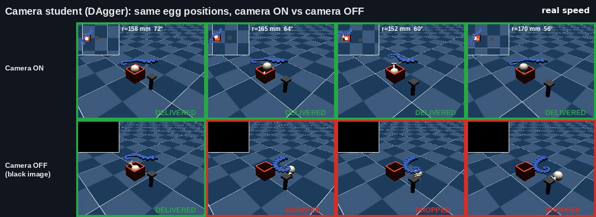
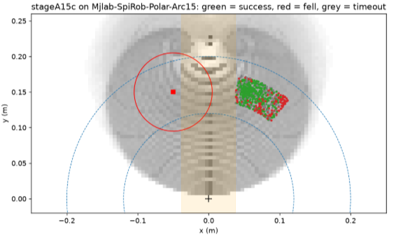
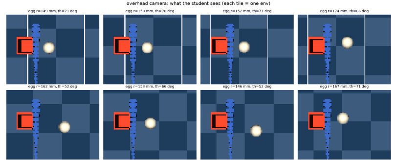

# SpiRob vision: from a blind policy to a camera student

A camera-based pick-and-place policy for **SpiRob**, a soft arm pulled by two cables. The arm picks an egg off a small
pedestal and drops it into a bucket, with the egg starting at many positions in a polar sector around the robot base.
Everything runs in simulation.

This repository covers the work after the **v3 ablation failure**: the first camera policy (v3) ignored its camera.
Blacking out, freezing or shuffling the image did not change its success, because the egg always started at the same
spot and one memorised motion was enough.

Built on [YADlin/spirob-mjlab](https://github.com/YADlin/spirob-mjlab), branch research/s2-spawn-randomization
(mjlab 1.4.0, mujoco / mujoco-warp 3.8.1, rsl-rl 5.2.0). **No upstream file is modified.** Everything here is standalone
and is copied into `spirob-mjlab/tools/` by the notebooks.



*Top row: camera on, egg delivered at all four positions. Bottom row: image blacked out, delivered only at the usual spot.
These are chosen examples; the measured rates are in the tables below.*

## Headline results

Evaluated on **Arc-1.5** (radius 139–179 mm, angle 51–76°), 512 episodes per row.

| | Nominal | Retention | Sector | Overall |
|---|---|---|---|---|
| model_499 (trained on one spot; tested on the wide sector) | 78% | 63% | 3% | – |
| **Teacher** (stageA15c, given the egg position) | 80% | 87% | **54%** | 65% |
| **Camera student** (DAgger, egg position hidden) | 86% | 82% | **43%** | **57%** |
| Camera student, image blacked out | 77% | 56% | 15% | 34% |

- The teacher lifts sector success from **3% to 54%**.
- The camera student reaches **88% of the teacher** overall (57 against 65).
- From the image alone the student locates the egg to about **4.5 mm** (about one pixel).
- Without the image, sector success falls from **43% to 15%**, and to 0% at 50–60°.

*Nominal* = the usual egg spot (158 mm from the base, 72°). *Retention* = small offsets around it.
*Sector* = anywhere in the trained region. Each reset is 10% nominal, 30% retention, 60% sector.

## Approach

```
v3 (camera + PPO, fixed egg)                  → blind: ignores its camera
v7 (camera + PPO, moving egg)                 → uses its camera, but only ~7% success
        │   reward alone is too weak a signal
        ▼
Privileged TEACHER (egg position as numbers)  → PPO, staged polar curriculum from sir's model_499
        │   workspace map + trajectory search show which spawns are reachable
        ▼
Camera STUDENT (80×60 overhead image)         → DAgger: copies the teacher, egg position hidden
        │
        ▼
Image ablations (black / frozen / swapped)    → the student depends on its camera
```

The problem is split in two. The **teacher** is told the egg position, so it only has to learn how to move.
The **student** has only a camera; the teacher gives it the right action at every step, so it only has to learn to see.

## Results in detail

### Teacher: staged PPO fine-tuning from model_499

| Run | Trained on | Iterations | Evaluated on | Nominal | Retention | Sector |
|---|---|---|---|---|---|---|
| model_499 (start) | one spot | – | Wide | 78% | 63% | 3% |
| Stage A | Arc-1 | 300 | Arc-1 | 96% | 67% | 52% |
| Stage B | Arc-2 | 300 | Arc-2 | 90% | 73% | 20% |
| A15 | Arc-1.5 | 500 | Arc-1.5 | 69% | 78% | 39% |
| A15b | Arc-1.5 | 500 | Arc-1.5 | 82% | 86% | 46% |
| **A15c (final)** | Arc-1.5 | 500 | Arc-1.5 | 80% | 87% | **54%** |

Widening straight to Arc-2 gave no gain (Stage A already scored 23% there), so the region was widened in a smaller step.

| Region | Radius | Angle |
|---|---|---|
| Arc-1 | 145–172 mm | 58–74° |
| Arc-1.5 | 139–179 mm | 51–76° |
| Arc-2 | 133–186 mm | 44–77° |



### Camera student against the teacher

| | Nominal | Retention | Sector | 50–60° | 60–70° | 70–80° | Overall |
|---|---|---|---|---|---|---|---|
| Teacher (A15c) | 80% | 87% | 54% | 33% | 69% | 55% | 65% |
| Camera student | 86% | 82% | 43% | 29% | 51% | 51% | 57% |

86% against 80% at nominal is within noise (about 50 nominal episodes each). The student is not better than its teacher.

### Does the student use its camera?

| Image shown to the student | Nominal | Retention | Sector | 50–60° | 60–70° | 70–80° | Overall | Egg error |
|---|---|---|---|---|---|---|---|---|
| Normal camera | 86% | 82% | 43% | 29% | 51% | 51% | 57% | 4.5 mm |
| Black image | 77% | 56% | 15% | 0% | 17% | 34% | 34% | 61 mm |
| Frozen first frame | 23% | 15% | 15% | 8% | 20% | 17% | 16% | 73 mm |
| Another robot's image (swapped) | 69% | 60% | 29% | 26% | 29% | 32% | 42% | 47 mm |

- **Black image:** away from the usual spot the policy is lost. At the usual spot a habit motion still works.
- **Frozen image:** success collapses everywhere, so the student watches the image during the whole motion.
- **Swapped image:** a clear drop, but the weakest of the three tests. Spawns are close together, so another robot's
  egg is often nearby. A far-swap version is planned.

For comparison, v3 showed no change under any image condition.

### The student network



- **Camera:** overhead, fixed to the robot base frame, looking straight down. 80×60 RGB, about 4.5 mm per pixel.
- **Other inputs (90 numbers):** cable length and speed, last action, touch, arm keypoints. The egg-to-bucket vector is hidden.
- **Encoder:** 3 convolution layers, then 32 spatial-softmax points and 64 pooled features (128 image features).
- **Policy head:** MLP 256 → 256 → 2 cable commands.
- **Auxiliary head:** predicts the egg position from the image features (MSE against the simulator's value, training only).
- About 190,000 weights, trained from scratch. No v3 or v7 weights are reused.
- **DAgger:** 256 robots, 10 rounds, teacher's share of the driving 100 / 50 / 30 / 20 / 10 / 0%, about 8 minutes per round on a T4.

### Negative results (kept on purpose)

| Attempt | Result | Why |
|---|---|---|
| Fine-tuning v3 with a moving egg | Best 8% | It had already learned to ignore the camera |
| v7 / v8: camera + PPO from scratch | About 7% at best | Reward alone could not teach seeing and moving together |
| Reproducing sir's Stage-1 run from scratch | Zero reward in five runs | The original run was seed luck |
| Jumping straight to Arc-2 | Sector 20%, no gain | New positions with no success give no reward |
| Behaviour cloning of trajectory-search motions | Nominal 96% → 0% | The motions are open-loop (timed); a feedback policy cannot imitate them |
| Trajectory search at 40–50° | No working motion | Probably unreachable with the current bucket position |

Full details of every run are in [`docs/EXPERIMENTS.md`](docs/EXPERIMENTS.md).

## How to run (Colab T4)

1. Open a notebook from notebooks/ and run its setup cell (clones spirob-mjlab, checks out the branch, uv sync).
2. The notebook writes the needed tools/*.py into the clone and runs everything in the foreground.
3. Checkpoints and outputs go to Google Drive/spirob_vision/<phase>/.

To reproduce the final result, run notebooks 08 → 09 (teacher) and then 11 (student). The student script has three modes:

```bash
# 1. look at what the camera sees
python tools/student_dagger.py --mode check --out $OUT

# 2. train the student from the teacher (10 DAgger rounds)
python tools/student_dagger.py --mode train --out $OUT --teacher $TEACHER_CKPT

# 3. evaluate, with or without tampering with the image
python tools/student_dagger.py --mode eval --out $OUT --student $OUT/student_last.pt --ablate none   # or black / frozen / swap
```

Checkpoints are not stored in git (see .gitignore). Upload the final teacher and student to a Release if they are needed online.

## Limitations

- **Simulation only.** Nothing has been tested on the physical robot. Lighting, colours and camera position were not varied.
- **One training run each.** The teacher and the student were each trained once, with one seed.
- **Arm keypoints.** The student still receives 42 arm-shape numbers from the simulator. They carry no egg information,
  but a real robot would not have them directly.
- **Limited region.** Arc-1.5 only. 50–60° is weak, 40–50° looks unreachable, and the left side is untouched.
- **The swap test is weak** in its current form.
- Overall rates (512 episodes) are good to about ±4 points at 95%; per-angle rates to about ±10.

## Next steps

- Student without arm keypoints (--no_keypoints), for a like-for-like comparison with v3.
- Far-swap ablation: show each robot the image of the robot whose egg is furthest away.
- A stronger and wider teacher: more seeds, the rest of the right side, then the left side (100–150°).
- Visual randomization (lighting, colours, camera pose) as the first step toward the real robot.
